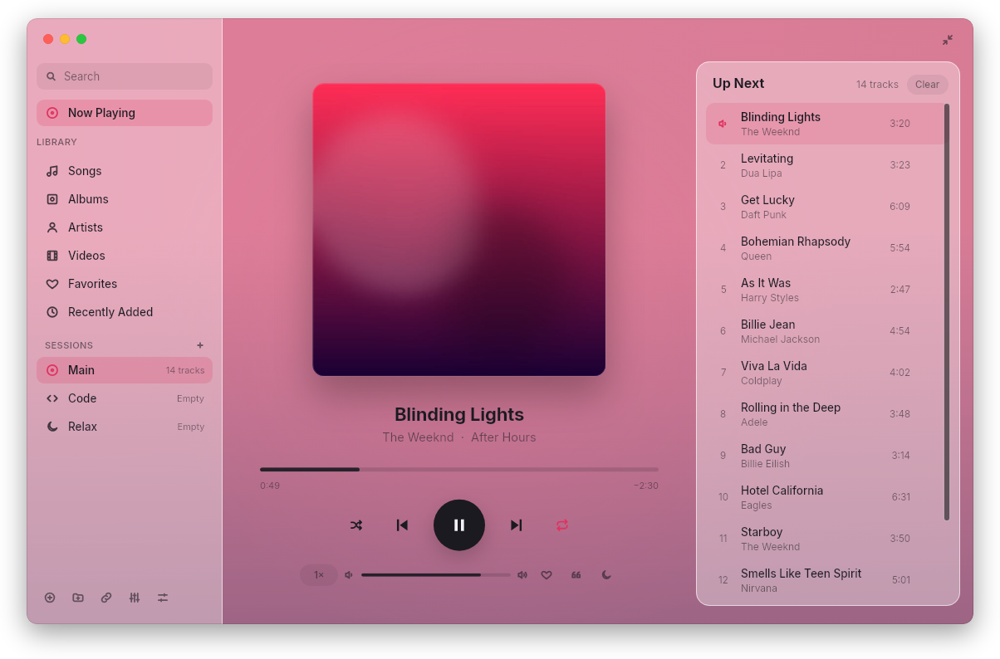
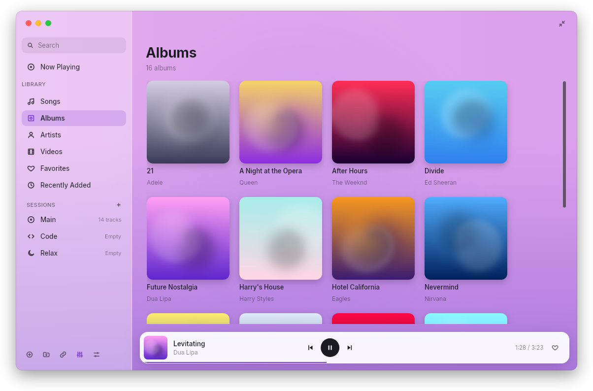
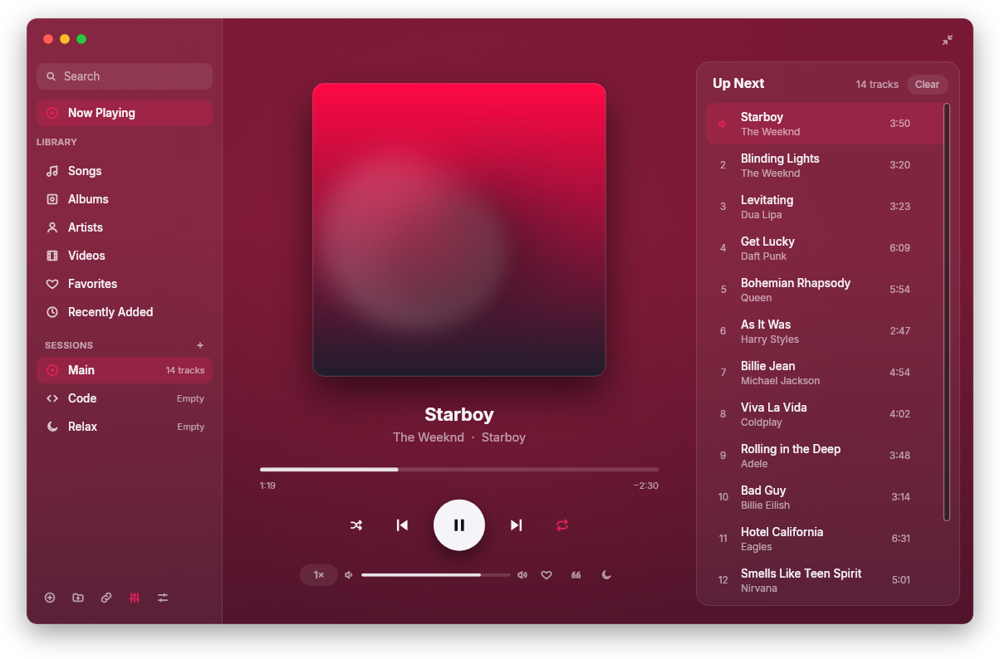
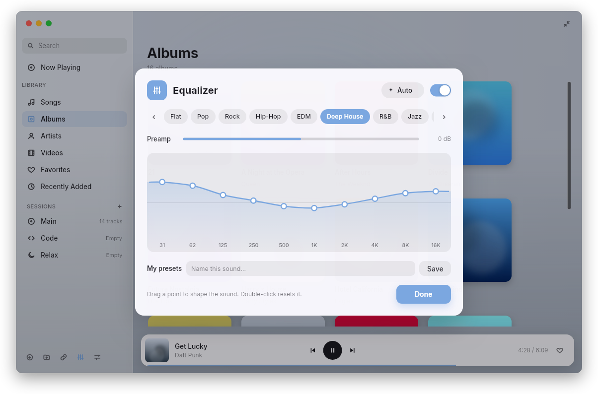
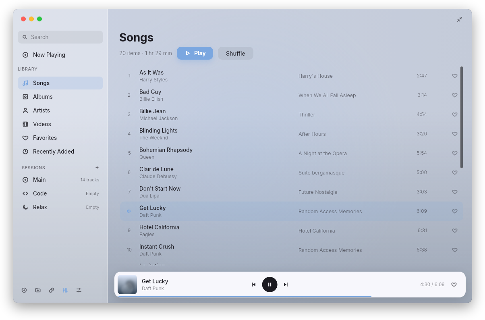
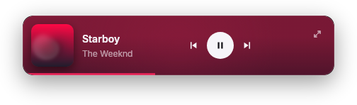

# Nava

**English** · [فارسی](README.fa.md)

A calm, glassy music and video player written in Rust. Slint for the interface, libmpv for playback.
Light on memory and CPU, with a "Code mode" mini player you can drive from your terminal.

<p align="center">
  
</p>

<p align="center">
  
  
</p>
<p align="center">
  
  
</p>
<p align="center">
  
</p>

<sub>Screenshots use made-up sample data.</sub>

## Download

| System | Download |
| --- | --- |
| **Windows** 10/11 (x64) | [Installer (.exe)](https://github.com/reza-hashemian/nava/releases/latest/download/nava-windows-x64-setup.exe) · [Portable (.zip)](https://github.com/reza-hashemian/nava/releases/latest/download/nava-windows-x64.zip) |
| **macOS** Apple Silicon (M1–M4) | [nava-macos-arm64.dmg](https://github.com/reza-hashemian/nava/releases/latest/download/nava-macos-arm64.dmg) |
| **macOS** Intel | [nava-macos-x86_64.dmg](https://github.com/reza-hashemian/nava/releases/latest/download/nava-macos-x86_64.dmg) |
| **Linux** any distro (x86_64) | [AppImage](https://github.com/reza-hashemian/nava/releases/latest/download/nava-linux-x86_64.AppImage) |
| **Debian / Ubuntu / Mint** (x86_64) | [.deb](https://github.com/reza-hashemian/nava/releases/latest/download/nava-linux-x86_64.deb) |
| **Fedora / openSUSE / RHEL** (x86_64) | [.rpm](https://github.com/reza-hashemian/nava/releases/latest/download/nava-linux-x86_64.rpm) |
| **Arch and others** (x86_64) | [.tar.gz](https://github.com/reza-hashemian/nava/releases/latest/download/nava-linux-x86_64.tar.gz) (needs `mpv` installed) |
| **Linux ARM64** (Raspberry Pi 5, …) | [AppImage](https://github.com/reza-hashemian/nava/releases/latest/download/nava-linux-aarch64.AppImage) · [.deb](https://github.com/reza-hashemian/nava/releases/latest/download/nava-linux-aarch64.deb) · [.rpm](https://github.com/reza-hashemian/nava/releases/latest/download/nava-linux-aarch64.rpm) · [.tar.gz](https://github.com/reza-hashemian/nava/releases/latest/download/nava-linux-aarch64.tar.gz) |

All versions: [Releases](https://github.com/reza-hashemian/nava/releases).

- **Linux:** the `.deb` / `.rpm` packages need Debian 12+, Ubuntu 24.04+ or a recent Fedora/openSUSE; on older systems use the AppImage (`chmod +x` it, then run).
- **macOS:** the app isn't signed with an Apple Developer ID. The first time, right-click Nava → **Open**, or run `xattr -dr com.apple.quarantine /Applications/Nava.app`.
- **Windows:** SmartScreen may warn about an unknown publisher: **More info → Run anyway**. Tick "Add nava to PATH" in the installer to use the `nava` command in a terminal.
- Links (YouTube and more) need [yt-dlp](https://github.com/yt-dlp/yt-dlp) on your PATH.

## Build from source

Needs Rust and libmpv (`sudo apt install libmpv-dev` on Debian/Ubuntu).

```sh
cargo run --release                      # open the last session where you left off
cargo run --release -- --code            # resume the Code session and start playing (fades in)
cargo run --release -- ~/Music --limit 20 --pick random
cargo run --release -- --help
```

## Code mode

`nava --code` opens the Code session in a small always-on-top mini player and
starts playing where you left off, fading in over three seconds. If Nava is
already open, the command goes to that window instead of starting a second one.

Control it without leaving your editor:

```sh
nava toggle | play | pause | next | prev
nava mini | full | show
nava status                                  # ▶ Title — Artist  1:23 / 3:45
nava status --format "{state} {title} · {pos}/{dur}"   # for tmux / your prompt
nava sleep 30 | end | off
nava speed 1.25
nava mark "closures explained here"
```

`status` prints nothing (exit code 1) when Nava isn't running, so it's safe in a prompt.
Fields: `{state} {title} {artist} {album} {pos} {dur} {session}`.

Global shortcuts (X11, Windows, macOS):

| Shortcut | Action |
| --- | --- |
| Ctrl+Alt+Space | Play / pause |
| Ctrl+Alt+. | Next |
| Ctrl+Alt+, | Previous |
| Ctrl+Alt+M | Mini player / full window |

Media keys and the desktop's "now playing" widget work through MPRIS on Linux
(`playerctl` works too) and through souvlaki on macOS and Windows.

## Library

Add the folders where you keep music and videos (the ⊕ button at the bottom of
the sidebar). Each session has its own library: folders you add in a session
show up only there (say, films in "Videos" and music in "Music"), while Main
shows every folder. Nava indexes them in the background and checks for new files
every ten minutes, re-reading only files that changed.

- Songs, Albums (a cover grid), Artists, Videos, Favorites, Recently Added
- Search as you type, across titles, artists, albums and file names
- The heart (or L) marks a favourite; play counts are kept for later mixes
- While browsing, a glass player bar sits at the bottom; click it to go back to Now Playing
- Click a song to play that whole list from there, or use Play / Shuffle
- Colours follow the artwork, or pick a fixed theme (Aurora, Sunset, Ocean…) in Settings
- The ↑ button shows the version and checks GitHub for a new release

To take a folder out of the library, open Settings (Ctrl+,) and press × next
to it. Its files stay on disk; Nava just stops listing them. Only real audio and
video files are indexed: `.ts` files are checked for an MPEG stream, so
TypeScript sources (`*.d.ts`) don't show up as videos.

## Sessions

Main, Code and Relax are always there; the + beside "SESSIONS" makes your own.
Each session keeps its own list, spot and volume. Right-click a session for
**Clear List** (empties it, files untouched) or **Delete Session** (yours only;
the × that appears when you hover one does the same).
"Clear" at the top of Up Next empties the current list.

Album covers for the grid are cached in `~/.cache/nava/albums` and only loaded
for rows on screen.

Right-click a song (in a list or Up Next) for **Play Next**, **Show in Folder**
and **Move to Trash**; the trash button also appears when you hover a row, and
Delete asks about the song that's playing. Files go to the system Trash (so they
can be restored), and leave the library and the queue. A song that's playing
moves on to the next one first.

## Lyrics

Y (or the quote button) shows lyrics beside Now Playing. Timed lyrics follow
the song like Apple Music: the line being sung is bright and the page glides
along; click a line to jump there. Nava looks for, in order, a `.lrc` file next
to the song, lyrics in the file's tags, then [LRCLIB](https://lrclib.net)
online (turn that off in Appearance). Online answers are cached in
`~/.cache/nava/lyrics`.

## Equalizer and screen lock

The equalizer (E, or the sidebar button) has 10 bands from 31 Hz to 16 kHz:
drag the points on the curve, double-click to reset one. 19 presets (Pop, Rock,
Hip-Hop, EDM, Deep House, R&B, Jazz, Classical, Acoustic, Podcast, Bass Boost…),
a preamp, and your own named presets.

**Auto** picks a preset for every song: from its genre tag when there is one,
otherwise from the file itself (mono or low-bitrate files and names like
"جلسه" or "voice" get Podcast, "mix" and "DJ" get EDM, the rest Pop; videos stay
Flat). The header shows what it chose, e.g. "AUTO · POP".

It runs inside mpv (`firequalizer`) and lowers the overall level by the biggest
boost so loud songs don't clip.

Music pauses when the screen locks and picks up again when you unlock
(GNOME and KDE). Turn it off in Appearance.

## Listening tools

- **Sleep timer** (moon button, or `nava sleep 30|end|off`): fades out over the
  last 30 seconds, pauses, and restores your volume. "End of track" stops after
  the current song.
- **Speed** (the 1× chip, or `nava speed 1.5`): 0.5× to 2×, pitch kept natural.
  Each folder remembers its own speed, so courses can stay at 1.5× and music at 1×.
- **A-B loop** (A key, or the loop button on videos): first press marks A, the
  second marks B and starts looping, the third clears it.
- **Notes on videos** (B key, the bookmark button, or `nava mark "note"` from a
  terminal): jot down what's happening at this moment. Click a time to jump
  back; ticks show on the scrubber. "Export .md" saves them as
  `<video>.notes.md` next to the video (or in `~/Documents/Nava Notes`).

## Links (YouTube and more)

Ctrl+L (or the link button in the sidebar) plays a link through
[yt-dlp](https://github.com/yt-dlp/yt-dlp); so does `nava URL`. "Audio only"
(`--audio-only`) skips the picture, which is much lighter for music and talks.
Video prefers H.264 up to 1080p, since that's what most GPUs (older Intel ones
included) decode in hardware. Thumbnails become the artwork and colours.

yt-dlp needs to be recent: sites change often. Debian's package lags behind;
the standalone release from GitHub updates itself with `yt-dlp -U`.

## Tray

On macOS, Windows, KDE and Ubuntu, Nava has a tray / menu-bar icon with
play/pause, next, previous, mini player and quit. There, closing the window
keeps the music going (a playing video pauses). Plain GNOME shows tray icons
only with the "AppIndicator and KStatusNotifierItem Support" extension
(`gnome-shell-extension-appindicator`); without a tray, closing the window quits
as before.

## Video

Video files play in the same window: the picture fills it, and QuickTime-style
glass controls float on top and fade out 2.5 s after the mouse stops. In mini
mode a video becomes a small always-on-top picture-in-picture window.

- Each video remembers where you stopped (cleared when you finish it).
- Subtitles next to the video load automatically, in Vazirmatn. Old Persian
  `.srt` files in Windows-1256 are detected and read correctly. They move up
  while the controls are showing.
- Subtitle and audio-track menus, fullscreen (F or double-click), Up Next panel.
- Hardware decoding through VA-API (on this libmpv it runs as `vaapi-copy`).
- "‹ Library" (or V) shows the library while the video keeps playing in the
  Now Playing card; click the video to go back to it.

Rendering: music is drawn by Skia on the CPU (fine edges, hinted text, light on
old GPUs). Video needs OpenGL, so when a video comes up Nava restarts itself
with OpenGL in about half a second and continues from the same spot. Force one
with `NAVA_RENDERER=gl`, `NAVA_RENDERER=skia`, or `NAVA_RENDERER=software`
(Slint's own renderer, the lightest).

The window is see-through, so on a compositing desktop (GNOME, KDE) its rounded
corners are smooth. Without a compositor, or with `software`, X11 cuts the
corners out instead (the SHAPE extension), which leaves them slightly stepped.

## Keys in the window

| Key | Action |
| --- | --- |
| Space | Play / pause |
| ← / → | Seek 5 s |
| ↑ / ↓ | Volume |
| N / P | Next / previous |
| Ctrl+O | Open a folder |
| Ctrl+, | Appearance (glass amount, theme) |
| Ctrl+M | Mini player / full window |
| Ctrl+L | Play a link |
| V | Video: switch between the video and the library |
| Esc / Backspace | Back from an album or artist |
| Delete | Move the playing song to the Trash (asks first; Enter confirms) |
| L | Favourite the current song |
| Y | Lyrics |
| E | Equalizer |
| A | A-B loop: mark A, mark B, clear |
| B | Notes panel (video) |
| F | Fullscreen (video) |
| Esc | Leave fullscreen / close a sheet |

## Where things live

- `src/mpv.rs`: minimal libmpv bindings
- `src/library.rs`: folder scanning, natural sort, "first / random / newest N"
- `src/meta.rs`: tags, cover art, colours from the artwork, blurred backdrop
- `src/catalog.rs`, `src/browse.rs`: the library index and its views
- `src/lyrics.rs`, `src/eq.rs`: lyrics lookup and LRC timing; equalizer and Auto
- `src/shape.rs`: rounded window corners on X11 without a compositor (the SHAPE extension)
- `src/store.rs`: sessions, settings and window positions in SQLite (`~/.local/share/nava/nava.db`)
- `src/ipc.rs`: single instance and terminal control over a local socket
- `src/system.rs`, `src/mpris.rs`: media keys, now-playing widget, global shortcuts
- `src/video.rs`: mpv draws video frames into OpenGL textures that Slint shows
- `ui/app.slint`, `ui/widgets.slint`: the interface

For tests, `NAVA_SOCKET=/path/to.sock` keeps a second copy of Nava apart from
the one you're using. Set `NAVA_AO=null` to run silently, e.g. for screenshots, and `NAVA_MPV_LOG=1`
(or an mpv `msg-level` like `all=v`) to see mpv's log.

Inter is bundled under the SIL Open Font License (`ui/fonts/Inter-LICENSE.txt`).

## License

[MIT](LICENSE)
